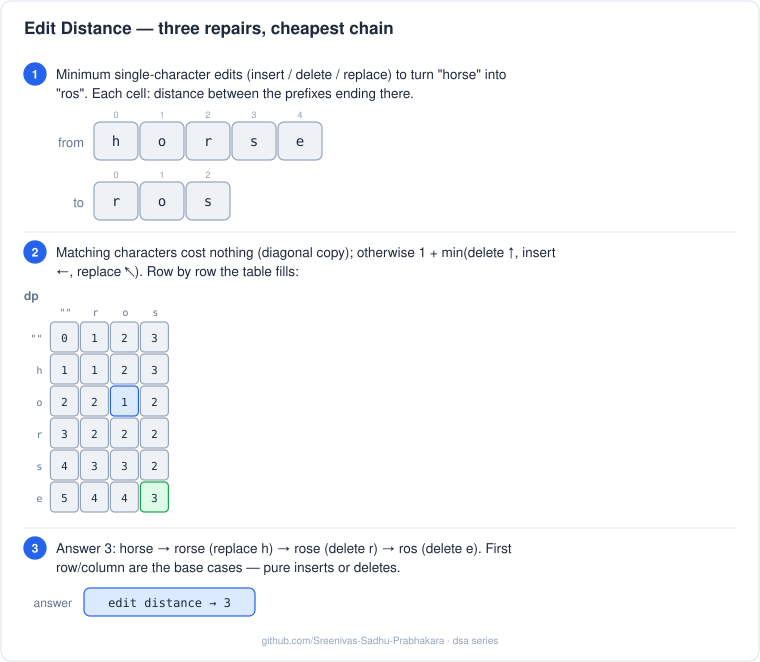

# Edit Distance

> Striver SDE Sheet 174 · Day 25 DP — Levenshtein: equal chars cost nothing; otherwise 1 + the best of substitute/delete/insert, each a neighbor cell. Go, stdlib only, tested.

## Problem

The minimum number of single-character edits — insert, delete, substitute — transforming one string into another. Spell checkers, fuzzy search, and DNA alignment all run on this number.

## Approach

State: the distance between prefixes a[:i] and b[:j]. Matching last characters cost nothing (diagonal move). Otherwise each of the three edits corresponds to exactly one neighbor cell — substitution to the diagonal, deletion to above, insertion to the left — and the answer is 1 + their minimum. Base cases are the degenerate transformations: building from or erasing to the empty string. Rolling two rows cuts memory to O(min side) just as in LCS — the two problems are cousins (`edit = n + m − 2·LCS` holds when substitution is disallowed). Symmetry is tested as a property.

**Complexity:** O(n·m) time, O(m) space.

## Visual walkthrough

Read the picture top to bottom — each numbered frame is one moment of the algorithm
running on this repo's test example.

## Run

    go test ./...   # verify
    go run .        # demo

---

One of 191 repos solving Striver's SDE Sheet in Go — stdlib only, one problem per repo, every solution tested. Browse the set: [`dsa-*` repos](https://github.com/Sreenivas-Sadhu-Prabhakara?tab=repositories&q=dsa-&type=source).
